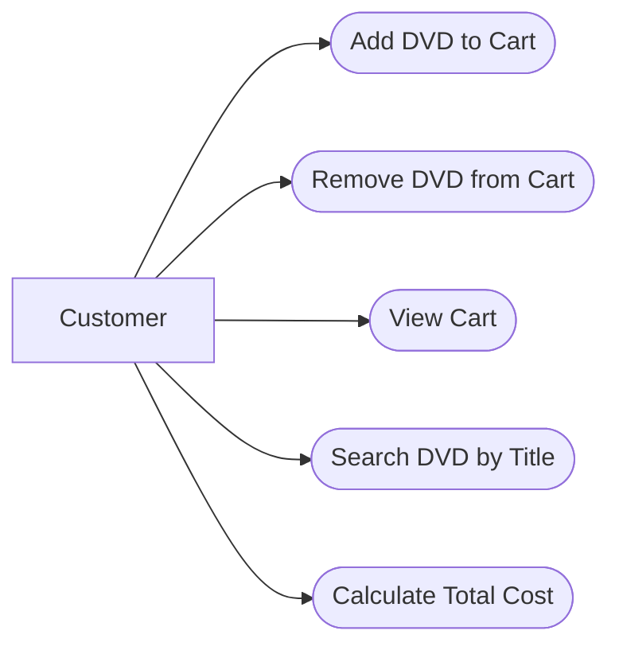

# AIMS-mini — Use Case Diagram

## 1. Actor
- Customer: Người sử dụng hệ thống AIMS-mini.

## 2. Use Cases
- Add DVD to Cart
- Remove DVD from Cart
- View Cart
- Search DVD by Title
- Calculate Total Cost

## 3. Use Case Diagram

